
<h1 class="serif" style="font-size:38px;margin:0">All projects</h1><a href="https://github.com/AissamDjahnine">GitHub profile →</a>

Featured projects with full write-ups, then course work and side projects. Research papers are in the <a class="text-link" href="/#research">Research</a> section.

<h2 class="serif sub-head" style="margin-top:28px">Featured projects</h2>

          
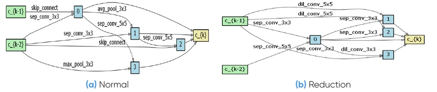

          
<h3>Neural Architecture Search for mammography (DARTS)</h3>
Master's thesis at GE Healthcare: DARTS architecture search for mammogram classification. The searched architecture beat the hand-designed baseline, 78.05% vs 75.03% accuracy on DDSM-Patches.

          
GE Healthcare · 2020AutoMLROC-AUC 0.92

          
<a href="/projects/nas-darts/">Project page →</a><a href="#internships">Internship details →</a>

          <a class="thumb" href="/projects/video-inpainting/">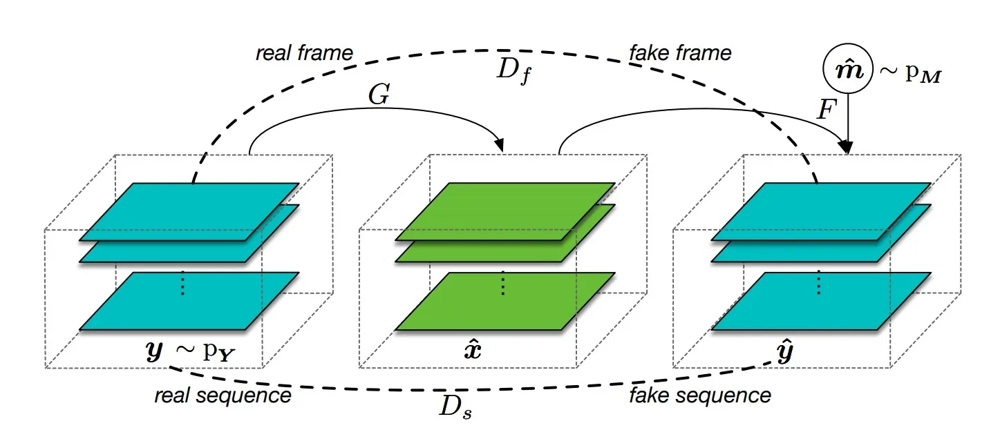</a>
          
<h3><a class="card-title-link" href="/projects/video-inpainting/">Unsupervised Spatiotemporal Data Inpainting</a></h3>
Course project with Ilyas Aroui and Abdelraouf Keskes: reimplementing unsupervised video inpainting with frame and sequence GAN discriminators on SST, FaceForensics++, KTH and BAIR.

          
GANVideoSorbonne · 2020

          
<a href="/projects/video-inpainting/">Project page →</a><a href="https://github.com/raoufkeskes/Unsupervised-Spatiotemporal-Data-Inpainting">GitHub ↗</a>

          <a class="thumb" href="/projects/handwritten-recognition/">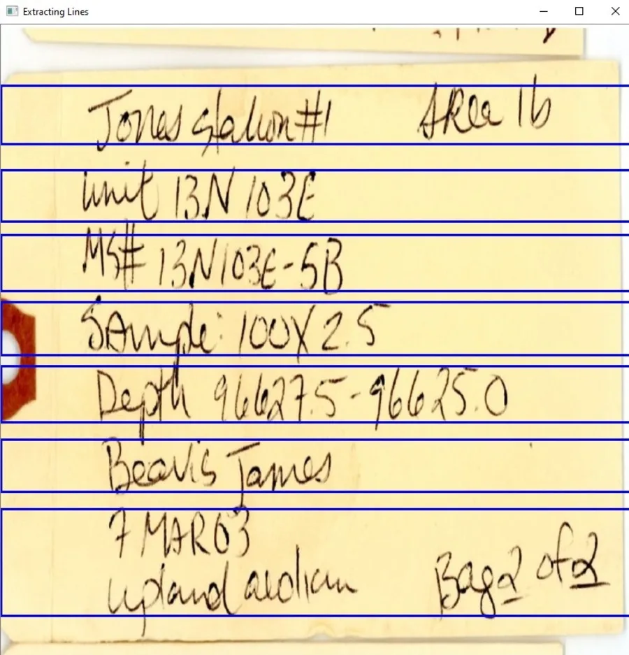</a>
          
<h3><a class="card-title-link" href="/projects/handwritten-recognition/">Handwritten Text Recognition System</a></h3>
Transcribing scanned handwritten museum labels: OpenCV line detection, Canny or YOLO character detection, and a Keras classifier for digits and letters (97% test accuracy).

          
OCRComputer vision2021

          
<a href="/projects/handwritten-recognition/">Project page →</a>

<h2 class="serif sub-head" style="margin-top:40px">More projects</h2>

<a class="thumb" href="/projects/cyclegan/">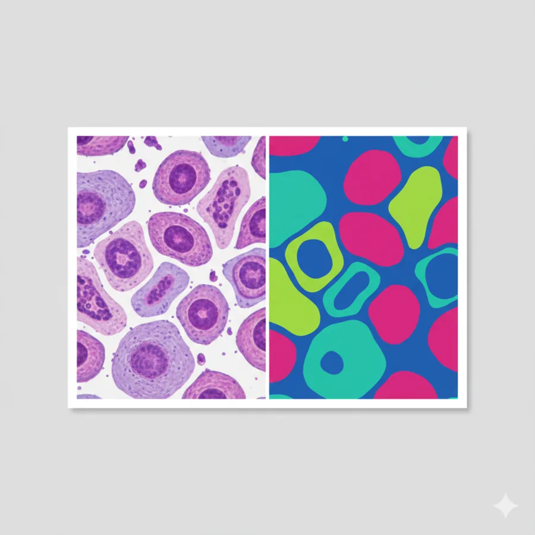</a>
<h3><a class="card-title-link" href="/projects/cyclegan/">CycleGAN cell segmentation</a></h3>
Automated segmentation of cell images using Cycle-Consistent Generative Adversarial Networks for medical imaging.

PythonDeep learningDice 0.79–0.87

<a href="/projects/cyclegan/">Project page →</a><a href="https://github.com/AissamDjahnine/CycleGAN">GitHub ↗</a><a href="/docs/reports/cyclegan-cell-segmentation-report.pdf">Report (PDF, 4 MB) ↗</a><a href="/docs/reports/cyclegan-cell-segmentation-slides.pdf">Slides (PDF, 2 MB) ↗</a>

<h3><a class="card-title-link" href="https://pontsmalins.com/">Ponts Malins</a></h3>
A France-first leave-planning web app that helps users optimize bridge days, public holidays, school-holiday-friendly breaks, and annual leave budgets.

TypeScriptWeb app

<a href="https://pontsmalins.com/">Live site ↗</a><a href="https://github.com/AissamDjahnine/vacation_optimizer">GitHub ↗</a>

<a class="thumb" href="https://github.com/AissamDjahnine/ColorTransfer">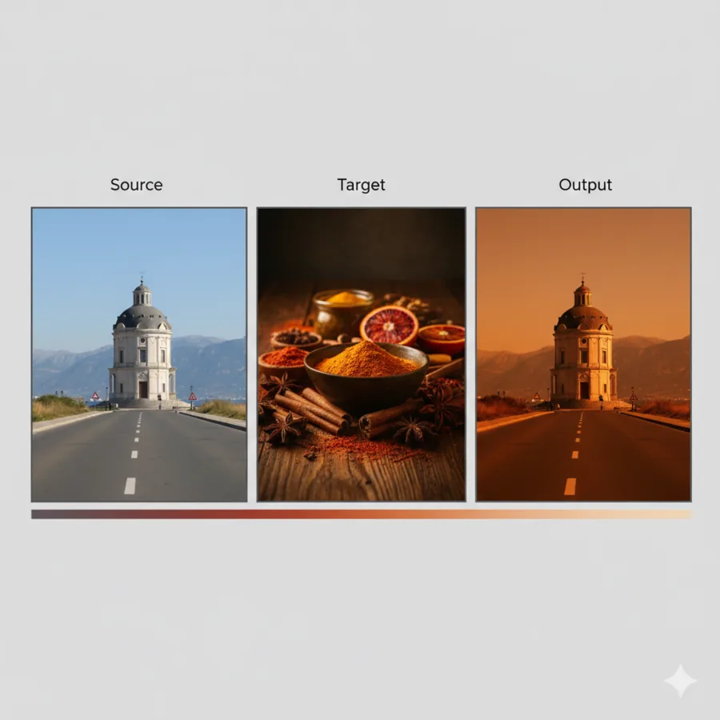</a>
<h3><a class="card-title-link" href="https://github.com/AissamDjahnine/ColorTransfer">ColorTransfer</a></h3>
Color transfer between images in a correlated color space for artistic and technical image manipulation.

PythonImage processing

<a href="https://github.com/AissamDjahnine/ColorTransfer">GitHub ↗</a>

<a class="thumb" href="https://github.com/AissamDjahnine/video-unscramble">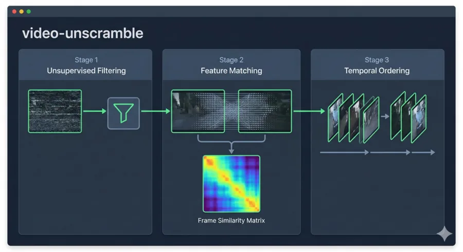</a>
<h3><a class="card-title-link" href="https://github.com/AissamDjahnine/video-unscramble">video-unscramble</a></h3>
Tooling to reconstruct or re-order scrambled video content, focusing on recovering coherent frame sequences from disrupted footage.

PythonVideo

<a href="https://github.com/AissamDjahnine/video-unscramble">GitHub ↗</a>

<h3><a class="card-title-link" href="https://github.com/AissamDjahnine/lateness-estimator">lateness-estimator</a></h3>
A Chrome Extension that injects humorous “arrival estimate” labels next to attendees in Google Calendar event details.

JavaScriptChrome extension

<a href="https://github.com/AissamDjahnine/lateness-estimator">GitHub ↗</a>

<a class="thumb" href="https://github.com/AissamDjahnine/Mouvement_estimation">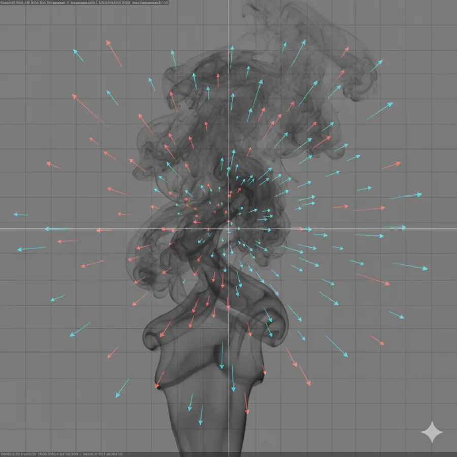</a>
<h3><a class="card-title-link" href="https://github.com/AissamDjahnine/Mouvement_estimation">Mouvement_estimation</a></h3>
Movement estimation implementation using the Horn &amp; Schunck optical flow method for pixel-level motion analysis.

CComputer vision

<a href="https://github.com/AissamDjahnine/Mouvement_estimation">GitHub ↗</a>

<a class="thumb" href="https://github.com/AissamDjahnine/Suppression-of-Acoustic-Noise-in-Speech-Using-Spectral-Subtraction-">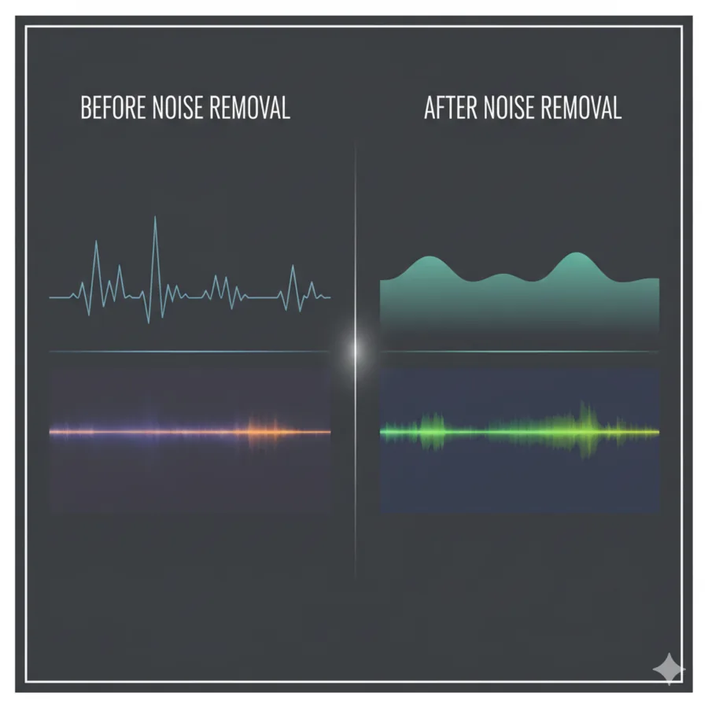</a>
<h3><a class="card-title-link" href="https://github.com/AissamDjahnine/Suppression-of-Acoustic-Noise-in-Speech-Using-Spectral-Subtraction-">Spectral Subtraction</a></h3>
Speech enhancement using the spectral subtraction technique based on Steven F. Boll's research work.

MATLABSignal processing

<a href="https://github.com/AissamDjahnine/Suppression-of-Acoustic-Noise-in-Speech-Using-Spectral-Subtraction-">GitHub ↗</a>

<a class="thumb thumb-ph" href="https://github.com/AissamDjahnine/markov-decision-process" aria-hidden="true" tabindex="-1">MDP</a>
<h3><a class="card-title-link" href="https://github.com/AissamDjahnine/markov-decision-process">Markov Decision Process</a></h3>
Explored decision-making under uncertainty with MDP modeling and dynamic programming principles for optimization across applied domains.

Reinforcement learning

<a href="https://github.com/AissamDjahnine/markov-decision-process">GitHub ↗</a>

<a class="thumb" href="https://github.com/AissamDjahnine/MDP-with-Value-Iteration-and-Policy-Iteration">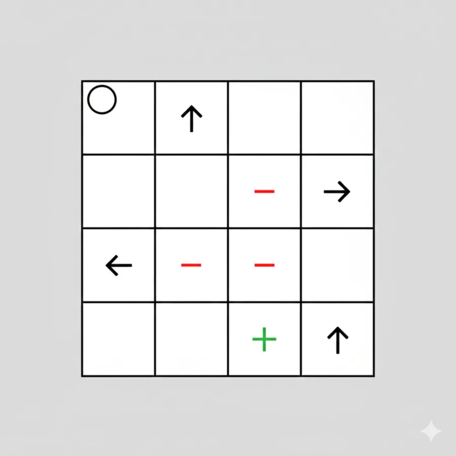</a>
<h3><a class="card-title-link" href="https://github.com/AissamDjahnine/MDP-with-Value-Iteration-and-Policy-Iteration">MDP with Value/Policy Iteration</a></h3>
Value and Policy Iteration algorithms explained for solving Markov Decision Processes in reinforcement learning.

Reinforcement learning

<a href="https://github.com/AissamDjahnine/MDP-with-Value-Iteration-and-Policy-Iteration">GitHub ↗</a>

<a class="thumb" href="https://github.com/AissamDjahnine/Search-Algorithms-in-AI">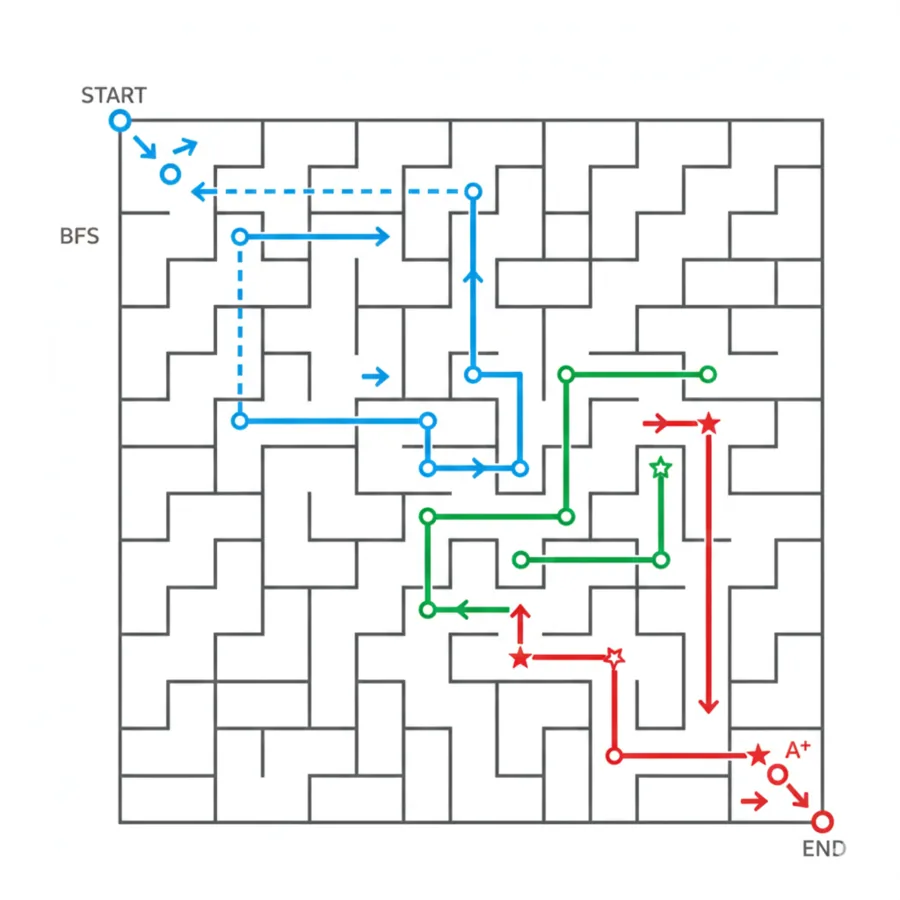</a>
<h3><a class="card-title-link" href="https://github.com/AissamDjahnine/Search-Algorithms-in-AI">Search-Algorithms-in-AI</a></h3>
Implementation of AI search algorithms including BFS, DFS, and A* for pathfinding and graph traversal problems.

MATLABAI

<a href="https://github.com/AissamDjahnine/Search-Algorithms-in-AI">GitHub ↗</a>

<a class="thumb thumb-ph" href="https://github.com/AissamDjahnine/Metro-Problem-" aria-hidden="true" tabindex="-1">Metro</a>
<h3><a class="card-title-link" href="https://github.com/AissamDjahnine/Metro-Problem-">Metro Problem (Dijkstra in Paris Subway)</a></h3>
Built a shortest-path tool over subway graph data with user-friendly station matching and efficient path computation in C++.

C++Optimization

<a href="https://github.com/AissamDjahnine/Metro-Problem-">GitHub ↗</a>

<a class="thumb" href="https://github.com/AissamDjahnine/Dijkstra">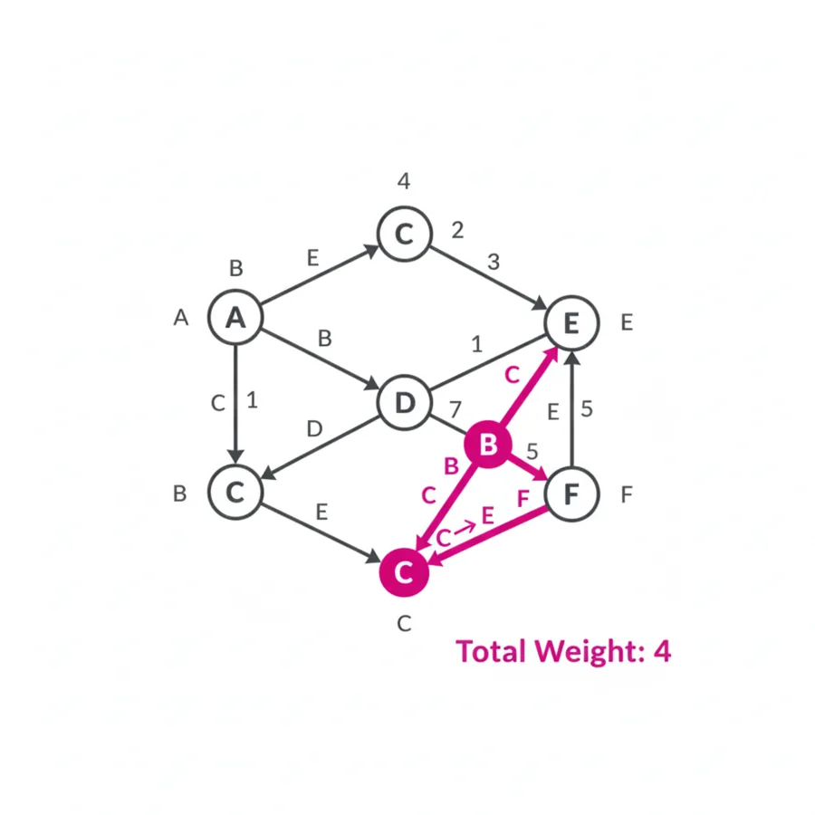</a>
<h3><a class="card-title-link" href="https://github.com/AissamDjahnine/Dijkstra">Dijkstra</a></h3>
Application of Dijkstra's shortest path algorithm for graph optimization problems.

C++Algorithms

<a href="https://github.com/AissamDjahnine/Dijkstra">GitHub ↗</a>

<h3><a class="card-title-link" href="https://github.com/AissamDjahnine/TCP-Server-Client">TCP-Server-Client</a></h3>
Basic TCP server-client implementation demonstrating socket programming and network communication protocols.

Networking

<a href="https://github.com/AissamDjahnine/TCP-Server-Client">GitHub ↗</a>

